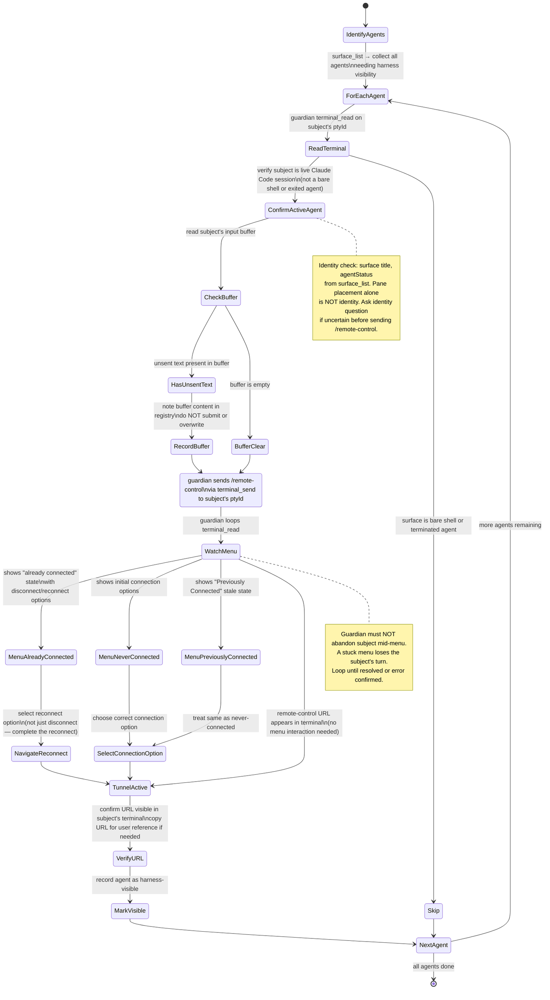

# claude-code-remote-control

Canonical agent procedure for recovering a Claude Code session's per-session `/remote-control` tunnel after an account switch invalidates it. Delegated-recovery pattern — not shared account state.

A session's Remote Control tunnel is per-session and per-account. After a login dance (account switch), every agent needing harness-level visibility (ListAgents, SendMessage) or user visibility on phone/web must have its tunnel refreshed. This cannot be done by the agent itself reliably — an external guardian must do it through the meta-harness.

---

## Why a guardian is required

`/remote-control` presents an interactive menu. An agent running it on its own session risks getting stuck in the menu and losing its turn. The guardian pattern externalizes the interaction: a separate agent (for example, a dispatcher) drives the command on each subject agent's terminal via meta-harness tools (wmux terminal_send, terminal_read).

---

## State Machine — /remote-control Recovery

---

## When to run this procedure

Run after every login dance (account switch). All sessions lose harness visibility when the account changes — Remote Control tunnels are per-session and per-account.

Also run when:
- An agent reports it cannot be found via ListAgents
- The operator cannot reach an agent on phone/web
- Remote Control shows "Previously Connected" stale state

---

## Priority order for recovery

Recover in this order:
1. The guardian agent itself (a dispatcher or equivalent) — must be harness-visible to coordinate others
2. The coordinator (a coordinator agent or equivalent) — needs harness visibility to manage subagents
3. Active subagents with ongoing work
4. Idle agents (can wait)

---

## Relation to login dance

This procedure is the final step of every login dance. The full dance state machine is part of the account-switch login procedure, which is not public. The `/remote-control` recovery runs at state `RemoteControlRecovery` in both Flow A and Flow B of that procedure.
